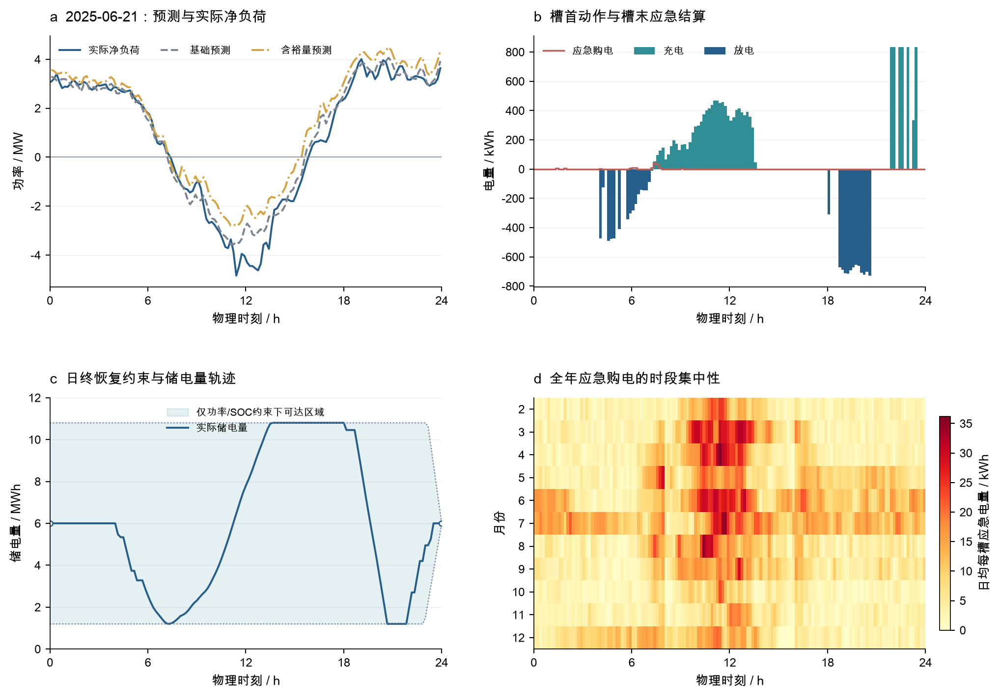
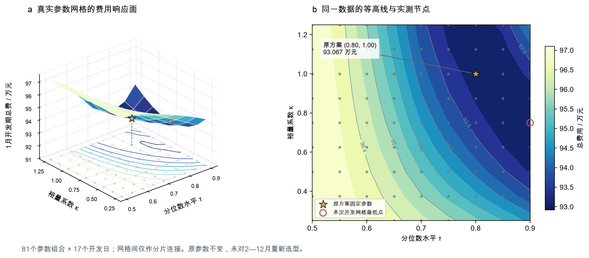
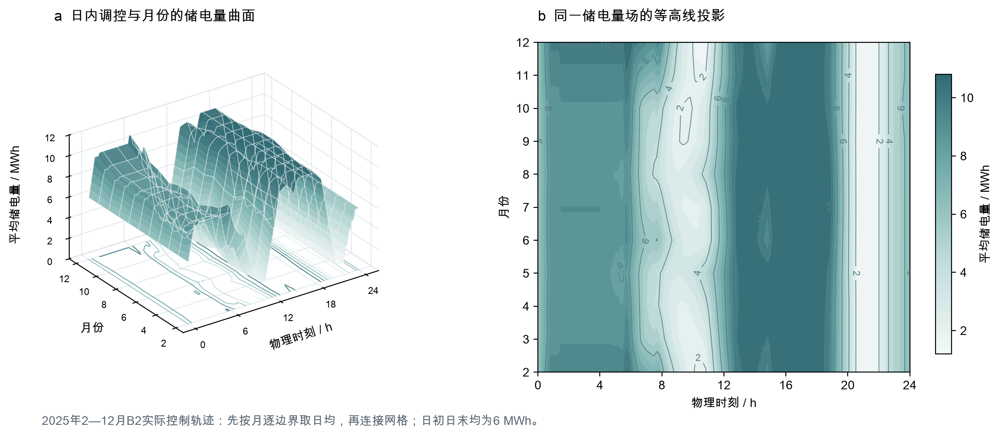

<div align="center">

# 2026 国赛 C 题：微网与外部电网电力调控

### 在统一时间语义下，把储能调度、预测误差与动态电价纳入同一条可复核链路

[](requirements-core.txt)
[](docs/model/README.md)
[](tests)
[](paper/latex/main.tex)
[](scripts/README.md)

2026 年全国大学生数学建模竞赛 · C 题

<br>

<table>
  <tr>
    <td align="center"><strong>4 / 4</strong><br><sub>真实候选方案</sub></td>
    <td align="center"><strong>5</strong><br><sub>官方结果表</sub></td>
    <td align="center"><strong>130</strong><br><sub>回归测试</sub></td>
    <td align="center"><strong>334 天</strong><br><sub>年度执行区间</sub></td>
    <td align="center"><strong>2,672</strong><br><sub>严格复核日轨迹</sub></td>
  </tr>
</table>

</div>

<p align="center">
  <a href="deliverables/candidate_figures/v2/research_figures_v2.pdf">
    
  </a>
</p>

## 项目要解决什么

本项目围绕微网负荷、光伏、储能和外部电网之间的电力调控，建立从题面与附件核验、时间轴冻结、统一储能内核，到四问计算、独立复核和官方结果表交付的完整研究链路。

核心计算链为：

> **题面与附件核验 → 数据与时间契约 → 统一储能内核 → 日前优化 → 因果执行与滚动 MPC → 动态电价迁移 → 论文与 Excel 交付**

项目的重点不是只输出一个最低费用，而是同时回答：储能如何改变日前调度、预测误差如何传导为应急购电、滚动更新是否值得，以及价格模块变化后哪些结论仍然成立。

## 当前状态

| 层级 | 当前状态 | 证据入口 |
| --- | --- | --- |
| 时间契约 | 技术口径封版为 `interval-end-v1`；官方表头语义与最终人工接收仍待验收 | [时间语义封版记录](docs/data/TIME_SEMANTICS.md) |
| 四问计算 | 4/4 题已有真实候选基础闭环，不等于最终竞赛验收 | [当前任务板](docs/current_tasks.md) |
| 官方 Excel | 五份按当前策略重导，352,466 格逐格回读通过 | [正式提交区](deliverables/final_submission/README.md) |
| 论文 | 工作区只保留一份当前论文，历史版本由 Git 承担 | [论文与交付](deliverables/README.md) |
| 最终验收 | 文献与竞赛格式验收尚未完成；动态电价下门控消融为可选增强 | [Gate 验证记录](docs/validation/GATE_STATUS.md) |

当前公开入口展示的是“已复核的技术候选”，不是已经通过全部题意、语义和竞赛格式验收的最终提交包。

## 经审计的主要结果

以下费用均为当前候选口径；年度结果覆盖 2025-02-01 至 12-31，应急费用已包含 5 倍系数。

| 问题 | 主候选 | 当前结果 | 解释边界 |
| --- | --- | ---: | --- |
| Q1 | 代表日确定性日前优化 | 35,126.95 元；较无储能下降 26.90% | 单日代表日候选，不直接等同全年提交结果 |
| Q2 | B2 安全裕量日前调度 | 15,137,987.06 元 | 334 天真实执行候选；风险模型不是当前主线 |
| Q3 | 裕量零点固定 | 15,129,676.16 元 | 门控消融为 15,122,320.83 元，仅低 0.0486%，不升级为主方案 |
| Q4 | 动态电价严格迁移 | `result4-2`：15,829,022.52 元；`result4-3`：15,822,900.47 元 | 价格提前可知是显式候选假设；裕量降幅 8.5842% |

Q4 的新预报重规划相对裕量方案仍增加 530,789.48 元（3.3546%）。这说明动态电价下的主要结论可以迁移，但不应把条件性价格信息假设写成题面已经明确给出的事实。

## 模型结构

### Q1｜确定性日前优化

统一储能与能量平衡内核比较无储能、规则调度和优化调度，输出代表日购电、充放电、SOC 和费用结果。

### Q2｜因果预测与安全裕量

在 0:00 可用信息边界下生成日前承诺，使用 B2 安全裕量应对预测误差，并通过槽首锁定动作、槽末实际结算检查未来数据泄漏。

### Q3｜滚动 MPC 与信息价值

在 0:00、6:00、12:00、18:00 的更新框架下锁定已发生时段，继承真实 SOC 和合同账本；固定更新和净收益门控作为对照与消融。

### Q4｜动态电价迁移

只替换价格输入，复用 Q2/Q3 的执行器、效率、终端条件和结算规则，比较安全裕量、裕量固定、新预报重规划及原动作重计价控制。

## 证据边界

| 证据或产物 | 可以支持的结论 | 不能直接支持的结论 |
| --- | --- | --- |
| `interval-end-v1` 时间契约 | 当前计算和导表使用同一套位置映射 | 不代表所有官方时间语义已完成最终人工接收 |
| 五份 `final_submission/excel/` | 当前策略、模板保真和逐格回读技术闭环 | 不代表竞赛格式和最终提交验收已经通过 |
| `full_oracle` | 事后信息下界和 Oracle Regret 参照 | 不能作为可执行策略或真实信息条件下的成绩 |
| Q4 动态价格结果 | 在显式价格可知假设下的迁移比较 | 不能证明未来价格天然提前可知 |
| `legacy_excel/` 与 `outputs/` | 历史策略、旧版本和回读证据 | 不得与当前论文或正式提交区混用 |

风险场景优化与复杂 SAA/CVaR 仍属于增强项；自适应 VOI 已完成对照，但因增益很小且跨月不稳定，保留为消融而未升级为主线。当前主线优先保持结果、论文和官方表格的一致性。

## 结果图谱

当前科研图册与三维候选图均保留数据来源和哈希清单：

### 三维候选图

<p align="center">
  <a href="deliverables/candidate_figures/v3_3d/q2_cost_response_3d.png">
    
  </a><br>
  <sub><strong>参数—费用响应面</strong>：分位数水平 τ 与裕量系数 κ 对一月费用的敏感性。81 个网格节点实际计算；原参数仍是全年主候选，网格最低点仅作描述性敏感性。</sub>
</p>

<p align="center">
  <a href="deliverables/candidate_figures/v3_3d/q2_soc_monthly_3d.png">
    
  </a><br>
  <sub><strong>日内—月份储电量曲面</strong>：2025 年 2—12 月 B2 实际控制轨迹的日均储电量，展示日内调度形状与月份差异；曲面连接仅用于观察，不代表某一天的可执行策略。</sub>
</p>

- [V2 科研图册（5 组、20 个子图）](deliverables/candidate_figures/v2/research_figures_v2.pdf)
- [两页 3D 候选图册](deliverables/candidate_figures/v3_3d/3D_candidate_atlas.pdf)
- [V2 图表说明与来源](deliverables/candidate_figures/v2/README.md)
- [V4 高级复合候选图说明](deliverables/candidate_figures/v4_advanced/README.md) · [montage 预览](deliverables/candidate_figures/v4_advanced/advanced_figures_montage.png)（`candidate-only`，未进入 `paper/`）
- [完整论文 PDF](paper/pdf/C_microgrid.pdf)

## 快速复现

所有命令从项目根目录运行：

```bash
.venv/bin/python -m unittest discover -s tests      # 130 项回归
.venv/bin/python scripts/verify_time_semantics.py   # 时间契约 34 项断言
.venv/bin/python scripts/verify_strict_q4.py        # 第四问 2,672 天复核
.venv/bin/python scripts/deliver_strict_excel.py    # 五份官方结果表
.venv/bin/python scripts/paper/build_pdf.py         # 论文
```

详细入口见 [scripts/README.md](scripts/README.md)。脚本对原始题面、附件和官方模板保持只读，派生结果写入独立目录；600 MB 量级的逐日轨迹与单元格转储不进入版本库，可由运行脚本重建。

## 交付入口

| 入口 | 内容 |
| --- | --- |
| [`paper/`](paper) | 唯一当前论文源文件与 PDF |
| [`deliverables/final_submission/excel/`](deliverables/final_submission/excel) | 五份当前策略官方结果表、摘要和哈希清单 |
| [`deliverables/`](deliverables) | 论文、图册、旧版本和审阅证据总览 |
| [`analysis/`](analysis) | 22 个实验目录和可追溯结果档案 |
| [`deliverables/review/packages/`](deliverables/review/packages) | 历史审阅包与历史目录快照，`historical`、`not-for-submission` |
| [`docs/`](docs) | 数据、模型、实验、验证和交付文档 |
| [`scripts/`](scripts) | 时间核验、四问运行、独立复核与构建入口 |

## 目录治理

项目目录按五类管理，具体边界见 [PROJECT_MAP.md](PROJECT_MAP.md) 和[仓库治理规则](docs/REPOSITORY_GOVERNANCE.md)：

- `CUMCM2026Problems/`：题面、附件和官方模板，只读；
- `data/`：标准化输入，只增不改；
- `src/`、`scripts/`、`tests/`：模型、运行入口和回归；
- `analysis/`、`outputs/`：实验与回读证据，保持原路径；
- `paper/`、`deliverables/`、`docs/`：论文、交付物和文档。

历史审阅包只归档在 `deliverables/review/packages/`；`scripts/verify_repository_layout.py` 可只读检查关键路径、候选图隔离和历史包位置。`.workbuddy-ai/` 是工具元数据，不作为项目事实来源，本轮不处理。

历史版本由 Git 记录，当前工作区只保留一份论文主线。文献与竞赛格式验收完成前，本仓库仍应标记为“候选交付”，不应称为最终封版包。
